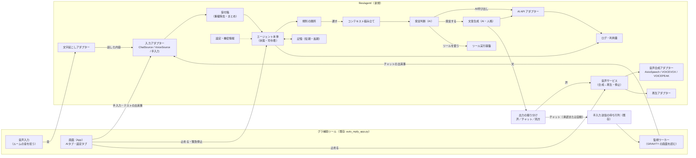
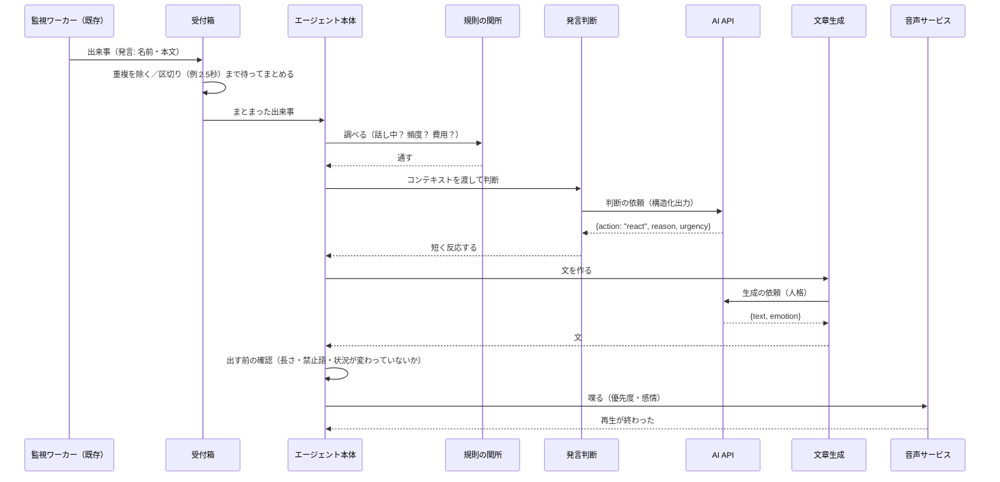
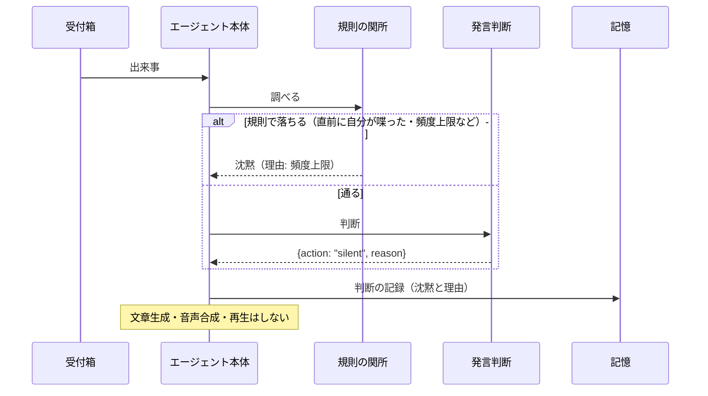
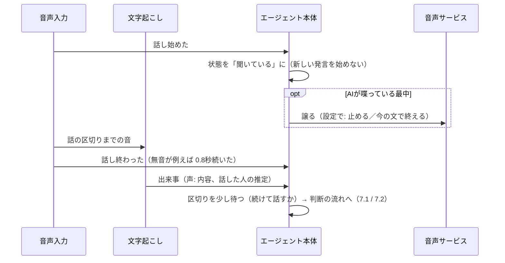
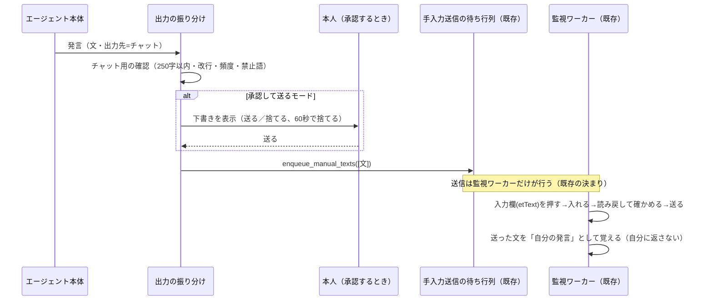

# 02 システム概要設計書

## 1. システムの目的

Windows PC 上で、チャットアプリ（現在は MuMu 上の GRAVITY の音声ルーム）の会話を取り込み、AI が状況を理解したうえで
「発言する」「処理だけする」「沈黙する」を自分で判断し、発言するときは音声合成で喋る。必要に応じて外部 API や
ローカルの機能（ツール）を使う。機能は後から足せるようにする。

2026-10-15 の追加要望: **他の人の声も聞く**。誰かが話し始めたら聞く側に回り、話し終わったら全体の内容から、
話すべきか・無視するかを決める。

## 2. 要件

### 2.1 機能要件

| ID | 要件 | 既存で満たすか |
|---|---|---|
| F1 | チャットアプリの会話（発言・お知らせ）を取り込む | **一部**（GRAVITY の読み取りはある。エージェントへ渡す口が無い） |
| F2 | 会話の流れ・状況から、発言の要否を判断する（沈黙・処理のみ・短い反応・積極的な参加・ツールを使ってから発言・保留/中断） | 無い |
| F3 | 人格（静か・落ち着き・親しみ・感情表現・冗談・洞察・割り込まない）で文章を作る | 無い |
| F4 | 文章を音声合成し、スピーカー（または選んだ出力先）で再生する | **一部**（合成・再生はある。止める・割り込むが無い） |
| F5 | AI API を提供元に依存せず使う。APIキーを入力・保存・削除・接続確認できる | 無い |
| F6 | 外部 API・ローカル機能を、登録したツールとして安全に実行する | 無い |
| F7 | 短期の会話コンテキストと長期の記憶を分けて持つ | 無い |
| F8 | 設定（提供元・モデル・話者・頻度・権限・上限・ログ）を管理する | **一部**（設定の保存はある） |
| F9 | 止める（AIの応答・音声・ツール）・緊急停止・復旧 | **一部**（監視・タスクは個別に止められる） |
| F10 | API 利用量・費用を記録し、上限で止める | 無い |
| F11 | チャットアプリが無くても、手入力・テスト用の出来事で判断〜再生を試せる | 無い |
| F12 | **他の人の声を拾い、話し始め・話し終わりを検知し、文字起こしして判断に使う。話している間は割り込まない** | 無い |
| F13 | **チャットで文字の会話をする**（2026-10-15 追加要望）: チャット欄の行（箱と値）を読み、入力欄（`etText`）に文字で返す。出力先を「声」「チャット」「両方」から選べる | **一部**（読む・書く仕組みはある。AI の判断とつながっていない） |

### 2.2 非機能要件

| ID | 要件 |
|---|---|
| N1 | 既存機能（自動返信・タスク・読み上げ・スマホ連携・更新）を壊さない。既存のテストが通り続ける |
| N2 | 機密情報（APIキー）をコード・平文の設定・ログに残さない |
| N3 | 沈黙と判断したときは、文章生成・音声合成・再生を一切しない |
| N4 | 連続発言・API の使いすぎ・無限の再試行を、規則で止められる |
| N5 | 外部・チャット由来の文字を「命令」として扱わない |
| N6 | 発言の判断から再生開始までの遅れを、会話として不自然でない範囲に収める（目標値は【要検証】。最初の目安: 判断〜再生開始 5秒以内） |
| N7 | 各アダプター（AI API・音声合成・再生・チャット・音声入力）を模擬に置き換えてテストできる |
| N8 | アプリを閉じるときに、AI の処理・再生・録音・ツールを止めて後片付けする |

## 3. 制約

| 種類 | 内容 |
|---|---|
| 実行環境 | Windows。exe は PyInstaller の onedir。自動更新は `robocopy /E` で上書き（足すだけで消さない） |
| 既存の作り | Python・CustomTkinter・スレッド。1ファイルの本体 |
| チャットアプリ | GRAVITY は公式 API が無い前提で、MuMu の画面を読む【公式APIの有無は未確認】。部品の名前は `GRAVITY画面部品.md` |
| 音声合成 | ローカルのエンジン（AivisSpeech・VOICEVOX）を HTTP で呼ぶ。エンジンが起動していないと喋れない |
| 公開リポジトリ | 機密情報・他の人の名前を置かない |
| AI API | 提供元未確定。インターネット接続と費用が要る |
| 音声入力 | ルームの音を PC で拾う方法は【要検証】（後述） |

## 4. エージェントを置く場所【要判断】

| 案 | 内容 | 良い点 | 弱い点 |
|---|---|---|---|
| **A（推奨）** | グラ補助ツールに組み込む（`files/agent/` に新しいモジュール） | チャット連携・音声合成・再生・出力先の選択・DB・テスト・配布の仕組みが揃っている | 本体が大きい（だから別モジュールにする） |
| B | ひといき（Electron）を広げる | AI API・APIキーの保存・人格の画面がある | チャットアプリ連携・VOICEVOX/AivisSpeech が無い。MuMu の操作を JavaScript で作り直す必要がある |
| C | 新しいアプリを作る | しがらみが無い | 既存の資産をほぼ全部作り直す |

以下は案Aの前提で書く。

## 5. 全体構成

**依存の向き**: 既存（Host）→ エージェント。エージェントは `auto_reply_app.py` を import しない。
GRAVITY 固有の処理（画面の部品）は既存側に残し、エージェントには「チャットの出来事」という共通の形で渡す。

## 6. コンポーネントの責務

| コンポーネント | 責務 | 持たないもの |
|---|---|---|
| 入力アダプター | チャット・音声・手入力を共通の「出来事（AgentEvent）」に変える | 判断 |
| 受付箱 | 重複の除去、短時間の出来事のまとめ（区切りを待つ）、上限付きの待ち行列 | 判断 |
| エージェント本体（Runtime） | 状態の管理、各段の呼び出し順、停止・緊急停止、古くなった結果の破棄 | AI の呼び出しの中身 |
| 規則の関所（Gate） | AI を呼ぶ前に、規則だけで沈黙/記録のみにできるものを落とす | 文章 |
| コンテキスト組み立て | 送る情報を選ぶ（直近の会話・自分の発言・判断の履歴・記憶・人格の要約） | 送信 |
| 発言判断（Decision） | 構造化出力で行動（沈黙・記録のみ・短い反応・参加・ツール・保留）と理由を決める | 発言の文 |
| 文章生成（Generator） | 人格に沿った、喋るための短い文と感情を作る | 再生 |
| ツール実行基盤 | 登録・検証・権限・承認・時間制限・記録 | どのツールを使うかの判断 |
| 記憶 | 会話・判断・発言・ツールの記録、長期記憶の保存・選択・削除 | ― |
| AI API アダプター | 提供元ごとの通信、共通の形への変換、時間制限、利用量 | 判断の中身 |
| 出力の振り分け（OutputRouter） | 発言を「声」「チャット」「両方」へ振り分け、出力先ごとの確認と承認を通す | 文章 |
| チャット出力（ChatOutput） | 既存の手入力送信の待ち行列へ渡す（送信そのものは監視ワーカー） | 画面の操作 |
| 音声サービス | 発言の順番、合成→再生、止める・割り込む、優先度 | 文章 |
| 音声合成アダプター | エンジンごとの合成（AivisSpeech を第一候補） | 再生 |
| 再生アダプター | 出力先へ鳴らす、途中で止める | 合成 |
| 音声入力・文字起こし | 音を拾う、話し始め/終わりの検知、文字起こし、話し中の状態を伝える | 判断 |
| 設定・機密情報 | 設定値、APIキーの暗号化保存 | ― |
| ログ・利用量 | 記録（機密は伏せる）、利用量と費用、上限の判定 | ― |

## 7. データと処理の流れ

### 7.1 発言する場合（チャットの発言から）

### 7.2 沈黙する場合

### 7.3 他の人が話しているとき（音声の検知）

### 7.4 チャットに文字で返す場合（2026-10-15 追加）

- 送った文が次にチャット欄に現れたら、出来事の `is_self=True` になり、判断の材料（自分の直近の発言）にだけ使う
- キーワード自動返信がONのときも、AI の文に自動返信が反応しないよう、既存の「自分の発言」の見分けを通す

### 7.5 止める・緊急停止

- 「AIを止める」: 新しい出来事を受け付けない。実行中の AI 呼び出しの結果は捨てる。再生は今の文で終える
- 「音声を止める」: 再生を即座に止め、待ち行列を空にする
- 「緊急停止」: 上の2つ＋実行中のツールの取り消し＋音声入力の停止。手で再開するまで何もしない

## 8. 音声の検知の方式（要検証の点）

| 論点 | 候補 | 状態 |
|---|---|---|
| ルームの音を拾う | (a) MuMu の音を出す出力デバイスの「ループバック」で録る、(b) MuMu の出力を仮想デバイス（VB-CABLE など）へ向け、その入力側から録る | 【要検証】sounddevice（今の依存）でのループバックの可否。今の環境では MME で動かしている（DirectSound は音が出なかった記録がある） |
| 自分の声を除く | AI の再生中・本人のマイクの音は「自分」として扱う（再生している時間帯の記録、出力先と入力元を分ける） | 【要検証】ルームの音に自分の声が戻ってくるか |
| 話し始め/終わりの検知 | 音の大きさによる簡易判定から始め、必要なら音声区間検出の部品を足す | 【要判断】新しい依存を入れるか |
| 文字起こし | ローカル（PC で動く認識エンジン）か、AI API の提供元の音声認識か | 【要判断】費用・精度・遅れ・個人情報の扱い |
| 誰が話しているか | ルームの席の部品（`vSideView` の中の音量の表示 `ivVolume` など）で、話している席を推定する | 【要検証】画面の部品で発話中がわかるか |

## 9. 未確定事項（この書類の範囲）

| 事項 | 影響 |
|---|---|
| エージェントを置く場所（4章） | 以降の全設計 |
| 応答の遅れの目標（N6） | 判断と生成を1回の AI 呼び出しにまとめるか、2回に分けるか |
| 音声の検知の方式（8章） | 音声入力の段階の作り・依存・費用 |
| GRAVITY の利用規約【未確認】 | 自動発言・音声の取り込みをどこまでやるか |
