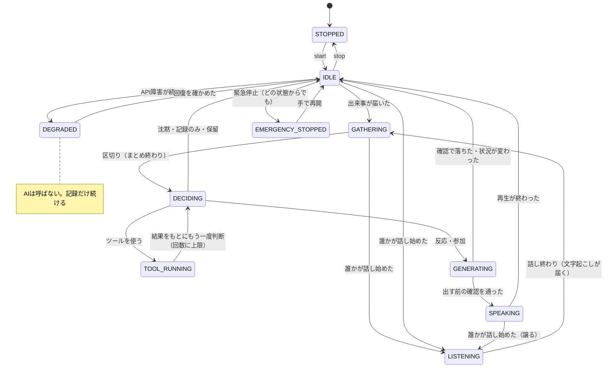
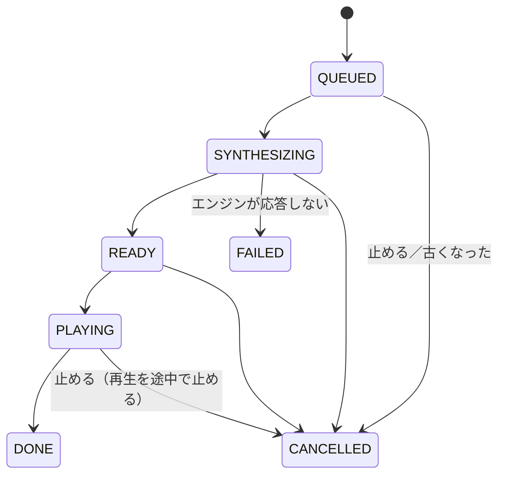
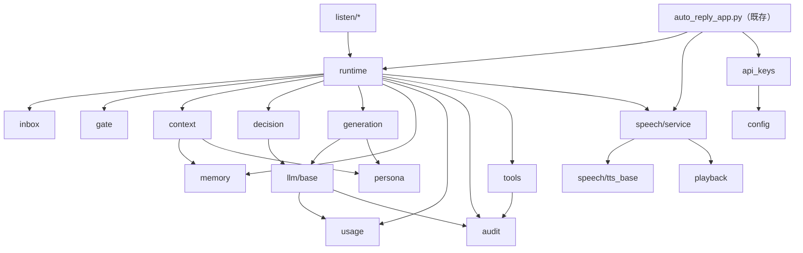

# 03 詳細設計書

この書類のインターフェースは **Python の型付きの擬似コード**で書く（実装の目安。名前は実装時に調整してよい）。
エージェント側のモジュールは**画面（tkinter）を import しない**。画面とのやりとりはコールバックか待ち行列で行う。

## 1. モジュール構成【推奨】

```
files/
├─ auto_reply_app.py          … 既存。画面と既存機能。エージェントを「作って・つなぐ」受け口を足す
└─ agent/                      … 新規パッケージ
    ├─ __init__.py
    ├─ events.py               … AgentEvent など、出来事の型
    ├─ inbox.py                … 受付箱（重複除去・まとめ・上限）
    ├─ runtime.py              … エージェント本体（状態・司令塔・停止）
    ├─ gate.py                 … 規則の関所
    ├─ context.py              … コンテキスト組み立て
    ├─ decision.py             … 発言判断（構造化出力の型と検証）
    ├─ generation.py           … 文章生成・出す前の確認
    ├─ persona.py              … 人格の設定
    ├─ config.py               … エージェントの設定（読み書きは既存の settings 表を経由）
    ├─ api_keys.py             … APIキーの暗号化保存（DPAPI）
    ├─ usage.py                … 利用量・費用・上限
    ├─ audit.py                … ログ（伏せ字つき）
    ├─ cancel.py               … 取り消しの合図（CancelToken）
    ├─ llm/                    … AI API アダプター
    │   ├─ base.py             … 共通インターフェースと型
    │   ├─ mock.py             … 模擬（テスト・手動試験用）
    │   └─ <提供元>.py         … 提供元が決まったら1つずつ足す
    ├─ output.py               … 出力の振り分け（声／チャット／両方）とチャット出力
    ├─ speech/                 … 音声（出す方）
    │   ├─ service.py          … 音声サービス（順番・優先度・停止）
    │   ├─ tts_base.py         … 音声合成の共通インターフェース
    │   ├─ voicevox_compat.py  … AivisSpeech・VOICEVOX（同じ HTTP の手順）
    │   ├─ playback.py         … 再生（途中で止められる）
    │   └─ mock.py
    ├─ listen/                 … 音声（聞く方）
    │   ├─ capture.py          … 音を拾う
    │   ├─ vad.py              … 話し始め/終わりの検知
    │   ├─ stt_base.py         … 文字起こしの共通インターフェース
    │   └─ mock.py
    ├─ tools/                  … ツール実行基盤
    │   ├─ spec.py             … ToolSpec・権限の型
    │   ├─ registry.py
    │   ├─ executor.py
    │   └─ builtin/            … 組み込みツール（必要になったら足す）
    └─ memory/
        ├─ store.py            … agent_data.db の読み書き
        └─ selection.py        … 長期記憶の選び方
```

**既存コードとの関係**

| 既存 | 扱い |
|---|---|
| `parse_chat_rows`・`chat_row_key`（GRAVITY の行の読み方） | 既存側に残す。監視ループから「出来事」に変えてエージェントへ渡す |
| `synthesize_voice_wav` など（`App` のメソッド） | 段階2で `agent/speech/` に同じ動きのものを作り、既存の読み上げもそちらを通す。**既存の動き（話者の選び方 `engine:ID`、キャッシュ、自動起動）は保つ** |
| `request_speech`・`_speech_worker` | 段階2で音声サービスへつなぎ替える。入口の関数名は残す（スマホ連携・クリップボードが呼んでいる） |
| `mask_screen_text` | ログの伏せ字に使う。APIキーらしい文字列を伏せる処理を足す |
| `DatabaseManager.get_setting/save_setting` | エージェントの設定（機密でないもの）の保存に使う |

## 2. 主なデータ型

```python
# events.py
@dataclass(frozen=True)
class AgentEvent:
    event_id: str            # 一意。重複判定に使う（下の key とは別）
    kind: Literal["chat_message", "chat_notice", "voice_utterance",
                  "voice_activity", "manual", "system"]
    source: str              # "gravity" / "voice" / "manual" / "test"
    key: str                 # 同じ出来事かの目印（GRAVITY は chat_row_key と同じ形）
    speaker: str | None      # 話した人（読めなければ None）。名前の末尾の「..」は残したまま
    text: str                # 本文（外から来た文字。命令として扱わない）
    observed_at: float       # 受け取った時刻
    meta: Mapping[str, Any]  # お知らせの種類、席番号、文字起こしの確からしさ など
    is_self: bool = False    # 自分（AI・本人）の発言とわかっているもの
```

```python
# decision.py
class Action(str, Enum):
    SILENT = "silent"        # 何もしない
    OBSERVE = "observe"      # 記録だけ（記憶・コンテキストに残す）
    REACT = "react"          # 短く反応
    ENGAGE = "engage"        # 積極的に参加
    USE_TOOL = "use_tool"    # ツールを使ってから発言を考える
    HOLD = "hold"            # 保留（今は話さない。少し後で見直す）

@dataclass
class Decision:
    action: Action
    reason: str              # 短い理由（ログ用。人に見せる前提で書かせる）
    urgency: float           # 0〜1
    target: str | None       # 誰に向けるか
    tool_request: ToolRequest | None
    hold_seconds: float | None
    decided_by: Literal["rule", "llm"]
    turn_id: str             # どの出来事のまとまりへの判断か
```

```python
# generation.py
@dataclass
class Utterance:
    text: str                # 喋る文（最大文字数は設定。既定 120）
    emotion: str             # "neutral" / "joy" / "calm" / "sad" / ... → 音声のスタイルに対応づける
    turn_id: str
    priority: int            # 小さいほど先
```

## 3. インターフェース

### 3.1 入力アダプター

```python
class EventSink(Protocol):
    def submit(self, event: AgentEvent) -> bool: ...   # 受付箱に入れる。満杯・停止中は False

# 既存側（auto_reply_app.py）が持つ。監視ループの中で、チャット欄の行を出来事に変えて submit する
class GravityChatBridge:
    def on_rows(self, rows: list[dict], display: str) -> None: ...  # 新しい行だけを AgentEvent にする
```

- **新しい行の見分け**: 前回までに見た `key` の集合と比べる（画面から消えたら忘れる。既存の返信済みの記録と同じ考え方）
- 起動直後に画面に出ている行は「過去の出来事」として `meta.backlog=True` を付けて渡す（反応はしないが、コンテキストには使える）

### 3.2 受付箱

```python
class Inbox:
    def __init__(self, max_size: int = 100, settle_seconds: float = 2.5): ...
    def submit(self, event: AgentEvent) -> bool
    def next_batch(self, timeout: float, cancel: CancelToken) -> list[AgentEvent]
        # 最後の出来事から settle_seconds たつか、強い合図（AIの名前を呼ばれた等）で返す
```

### 3.3 エージェント本体

```python
class AgentRuntime:
    def __init__(self, deps: AgentDeps, config: AgentConfig): ...
    def start(self) -> None          # 専用スレッドを1本立てる
    def stop(self) -> None           # 新しい出来事を受け付けない。今の処理が終わったら止まる
    def emergency_stop(self) -> None # 即座に止める（AI 呼び出しの結果は捨てる、音声・ツール・聞き取りを止める）
    def resume(self) -> None         # 緊急停止から手で戻す
    @property
    def state(self) -> RuntimeState
    def on_voice_activity(self, speaking: bool, who: str | None) -> None  # 聞いている間は話し始めない
```

`AgentDeps` には、LLM・音声サービス・記憶・ツール・設定・ログ・時計（テストで差し替える）を渡す。

### 3.4 出力の振り分けとチャット出力（2026-10-15 追加）

```python
# output.py
class OutputChannel(str, Enum):
    VOICE = "voice"
    CHAT = "chat"
    BOTH = "both"

class ChatSender(Protocol):            # 既存側（auto_reply_app.py）が実装して渡す
    def enqueue(self, texts: list[str]) -> tuple[int, str]: ...   # 中身は AutoReplyWorker.enqueue_manual_texts

class ChatApproval(Protocol):          # 画面が実装（下書きを見せて、送る／捨てる）
    def ask(self, draft: str, timeout_seconds: float) -> bool: ...

class OutputRouter:
    def __init__(self, speech: SpeechService, chat: ChatSender | None,
                 approval: ChatApproval | None, config: OutputConfig): ...
    def emit(self, utterance: Utterance, channel: OutputChannel, cancel: CancelToken) -> OutputResult
```

| チャット出力の決まり | 内容 |
|---|---|
| 送り方 | 既存の手入力送信の待ち行列へ入れるだけ。**送信は監視ワーカーだけ**が行う（既存の決まり。別スレッドから直接押すと、画面が重なって別の画面を触る事故が起きた） |
| 監視が動いていないとき | 送れない（`enqueue` が「監視中ではない」を返す）。その発言は捨てて記録 |
| 文字数 | 1通 250字以内（既存の手入力の上限の設定を使う）。超えたら送らない（途中で切らない） |
| モード | 「承認して送る」（下書きを画面に出し、送る／捨てる。60秒で捨てる）／「自動で送る」。既定は承認 |
| 自分の発言 | 送った文は既存の `_recent_manual_texts` に入る（自分に自動返信しない）。出来事としても `is_self=True` |

### 3.5 AI API・音声合成・再生・文字起こし

[05_アダプター設計書.md](05_アダプター設計書.md) を参照。

### 3.6 ツール

[06_ツール実行・セキュリティ設計書.md](06_ツール実行・セキュリティ設計書.md) を参照。

## 4. 状態遷移

### 4.1 エージェント本体



| 状態 | 新しい出来事 | AI 呼び出し | 発言 |
|---|---|---|---|
| STOPPED | 受け付けない | しない | しない |
| IDLE | 受け付ける | ― | ― |
| GATHERING | 受け付けてまとめる | しない | しない |
| LISTENING | 受け付ける（声の文字起こしを待つ） | しない | **始めない** |
| DECIDING / GENERATING / TOOL_RUNNING | 受け付けて次のまとまりへ | する | ― |
| SPEAKING | 受け付けて次のまとまりへ | しない | 再生中 |
| DEGRADED | 受け付けて記録だけ | **しない** | しない |
| EMERGENCY_STOPPED | 受け付けない | しない | しない |

### 4.2 1回の発言（音声サービス）



## 5. 並行処理

**スレッドと待ち行列**で組む（既存と同じ）。asyncio は使わない。

| スレッド | 役目 | 待ち行列（上限） |
|---|---|---|
| 画面（既存のメイン） | 操作・表示。ワーカーからは `_post_to_ui` で受け取る | 伝言板（既存） |
| 監視ワーカー（既存） | GRAVITY を読む → `EventSink.submit` | 受付箱（100） |
| エージェント（新規・1本） | 受付箱から取り出し、関所→判断→生成→音声サービスへ | ― |
| AI 呼び出し | エージェントのスレッドの中で同期呼び出し（時間制限つき）。取り消しは「結果を捨てる」で行う | ― |
| ツール実行（新規・最大2本） | 時間制限つきで実行。間に合わなければ取り消しを試み、結果は捨てる | ツールの待ち（10） |
| 音声: 合成（新規・1本） | 合成して再生の待ちへ。次の文を先に合成しておける | 合成待ち（10） |
| 音声: 再生（新規・1本） | 1つずつ再生。途中で止められる | 再生待ち（10） |
| 音声入力（新規・1本） | 拾う→区切る→文字起こし | 区切った音（5） |

**競合と重複の防ぎ方**

| 問題 | 対策 |
|---|---|
| 再生の重複・競合 | 再生は1本のスレッドだけが行う。既存の読み上げも同じ音声サービスを通す（段階2） |
| 複数のコメントへの同時反応 | 受付箱が区切りまで待ってまとめ、1回の判断にする。判断は1本のスレッドで順番に |
| 同じコメントの重複処理 | `event_id` と `key` で除く（見えている間だけ覚える）。判断の記録にも `turn_id` を残す |
| AI の応答待ちの間に状況が変わった | 判断・生成の結果に `turn_id` と「その時点の最新の出来事の番号」を付け、喋る直前に**新しい出来事が来ていれば捨てるか判断し直す** |
| ツール実行中の取り消し | `CancelToken` を渡す。ツールは合図を見て止まる作りにする。止まらなければ結果を捨てる |
| 再生中の停止・割り込み | 再生は短い区切り（例 50ms）ごとに取り消しを確かめる |
| 無限ループ・過剰な再試行 | ツール→判断のやり直しは1つのまとまりで最大2回。AI の再試行は1回まで（SDK の自動再試行と二重にしない） |
| 連続発言・使いすぎ | 関所で「直前の発言から最低◯秒」「1分・1時間の発言回数」「1日の費用」を見る |
| 終了時の後片付け | `App.on_closing` から `AgentRuntime.stop()`→音声サービスの停止→音声入力の停止→スレッドの終わりを待つ（既存の `_check_thread_and_destroy` と同じ待ち方） |

## 6. エラー処理

| 起きること | 再試行 | その後の状態 | 本人への知らせ |
|---|---|---|---|
| AI API の時間切れ | 1回まで（短い待ちを入れて） | だめなら沈黙。続けば DEGRADED | ログ。続けば画面に表示 |
| AI API の 429（使いすぎ）・5xx | 1回まで（相手の指示する待ち時間を守る） | 同上 | 同上 |
| AI API の 400・認証エラー | しない | DEGRADED（設定を直すまで） | 画面に表示（「APIキーを確かめてください」）。キーは表示しない |
| 構造化出力が型に合わない | 1回だけ作り直しを依頼 | だめなら沈黙 | ログ |
| 提供元が回答を拒否した | しない | 沈黙 | ログ |
| 音声合成エンジンが応答しない | しない（エンジンの自動起動の設定があれば起動を試す） | その発言は捨てる | 画面に表示（既存の読み上げと同じ文） |
| 出力デバイスが無い | 既定のデバイスへ（既存と同じ） | ― | 1度だけ表示（既存） |
| ツールの失敗・時間切れ | ツールの定義による（既定はしない） | 失敗を判断に返して、もう一度判断（回数に上限） | 監査ログ |
| 想定外の例外 | しない | そのまとまりを捨てて IDLE へ。スレッドは止めない | `error_log.txt`（既存の `write_error_log`） |

**DEGRADED（AI を呼ばない状態）**: 直近の AI 呼び出しが続けて失敗した（例: 3回）ら入る。一定時間（例: 60秒）ごとに軽い確認（接続確認と同じもの）をし、通れば戻る。

## 7. モジュールの依存関係



- `agent/` の中から `auto_reply_app` を import しない（D3）
- 画面は `runtime` と `speech/service` と `api_keys` だけを触る
- 提供元ごとの SDK は `llm/<提供元>.py` の中だけで import する（入っていなくても他は動く）
