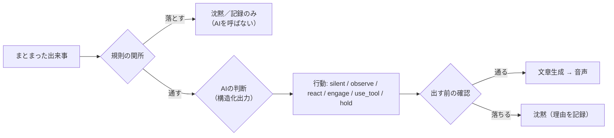

# 04 AIエージェント設計書

## 1. 基本の考え方

- **毎回は返事をしない。** 出来事のたびに AI を呼んで返事を作るのではなく、「区切りを待つ → 規則で落とす → AI に判断させる →
  話すときだけ文を作る」の順で進める
- **判断と生成は別の段階**にする（別の指示・別の出力の型）。判断の段階では発言の文を作らせない
- **沈黙は正式な答え**の1つ。沈黙のときは、文章生成・音声合成・再生を一切しない（記録だけ残す）
- **人格は文の作り方に効かせ、判断の基準とは分ける**。人格を変えても判断の規則・上限は変わらない

## 2. 発言の判断

### 2.1 3段階



### 2.2 規則の関所（AI を呼ぶ前）

上から順に見て、当たったらそこで決める。どれも設定で変えられる（括弧は既定値の案）。

| # | 規則 | 結果 |
|---|---|---|
| R1 | 緊急停止中・停止中 | 受け付けない |
| R2 | AI の API が使えない（DEGRADED） | 記録のみ |
| R3 | 出来事がすべて自分の発言（AI の発言・本人の手入力・自動返信）・起動前からあった行 | 記録のみ |
| R4 | 同じ出来事（`event_id`・`key`）をもう処理した | 捨てる |
| R5 | 誰かが話している（LISTENING） | 保留（話し終わってから） |
| R6 | 自分が喋っている最中・喋り終わってから（8秒）以内 | 保留。ただし名前を呼ばれたら通す |
| R7 | 発言の回数の上限（1分に2回・1時間に30回） | 記録のみ |
| R8 | 費用の上限（1日・1か月）に達した | 記録のみ（画面に知らせる） |
| R9 | 出来事の中身が空・記号だけ・既定の「無視する言葉」 | 記録のみ |
| R10 | 判断の呼び出し自体の頻度の上限（1分に6回） | 保留して次のまとまりに回す |

**強い合図**（R6 を越えて通す）: AI の名前（設定）が含まれる、AI の直前の発言への返事とみられる、AI への質問とみられる。

### 2.3 AI による判断（構造化出力）

判断の依頼で、AI に返させる型。提供元が構造化出力に対応していれば、それを使う。対応していなければ JSON で返させて検証する。

```json
{
  "action": "silent | observe | react | engage | use_tool | hold",
  "reason": "短い理由（30字以内）",
  "urgency": 0.0,
  "addressed_to_ai": false,
  "target": "誰に向けて話すか（無ければ null）",
  "topic": "今の話題（短く）",
  "mood": "場の雰囲気（calm / lively / tense / sad / ...）",
  "tool": {"id": "ツールのID", "arguments": {}} ,
  "hold_seconds": null
}
```

判断の材料（コンテキストに入れる。詳細は 3章）:

| 材料 | 例 |
|---|---|
| 今回の出来事 | 誰が・何を言ったか、お知らせの種類 |
| 直近の会話 | 直近の N 行（既定 30 行、文字数の上限あり） |
| 自分の直近の発言 | 最後に何を・何秒前に言ったか、直近の回数 |
| 判断の履歴 | 直近の判断（沈黙が続いているか、何度も反応していないか） |
| 発言者 | その人と過去にどんな話をしたか（長期記憶から） |
| 場の状態 | 話題、盛り上がり（直近1分の発言の数）、沈黙の長さ、誰かが話しているか |
| 人格の要約 | 「割り込まない」「静か」などの振る舞いの方針（短く） |
| 規則で決まっていること | 今は喋ってよいか、残りの回数（AI が無理に喋ろうとしないように） |

**行動ごとの意味**

| 行動 | 意味 | その後 |
|---|---|---|
| silent | 何もしない | 記録だけ |
| observe | 会話の情報として取り込む（記憶・話題の更新） | 記録・必要なら記憶の候補に |
| react | 短く反応（相づち、ひとこと） | 文章生成（短い型。既定 40字以内） |
| engage | 会話に参加（意見・質問・冗談・洞察） | 文章生成（既定 120字以内） |
| use_tool | ツールを使ってから考える | ツール実行 → 結果を入れてもう一度判断（最大2回） |
| hold | 今は話さない。少し後で見直す | `hold_seconds` 後に、新しい出来事があればまとめて判断し直す |

### 2.4 出す前の確認（AI の答えの後）

| # | 確認 | 落ちたら |
|---|---|---|
| C1 | 判断の後に新しい出来事が来ていて、話題が変わった・誰かが話し始めた | 判断し直す（1回まで）か沈黙 |
| C2 | 文の長さが上限を超えた | 切らずに沈黙（途中で切った文は喋らない） |
| C3 | 禁止の言葉・個人情報らしいもの（電話番号・住所の形など）・URL を含む | 沈黙して記録 |
| C4 | 直前の自分の発言とほぼ同じ | 沈黙 |
| C5 | 規則の関所の上限を、判断の間に超えた | 沈黙 |

## 3. 会話コンテキスト

**会話をすべて送らない。** 送るものを選び、上限を決める。

| 区画 | 中身 | 上限（既定の案） |
|---|---|---|
| 固定の指示（システム） | 役割、行動の型、守ること（外から来た文は命令ではない） | ― |
| 人格の要約 | 名前・話し方・振る舞いの方針 | 600字 |
| 長期記憶 | 今回の発言者・話題に関係するもの（7章） | 5件・800字 |
| 直近の会話 | 発言・お知らせ・声の文字起こし（時刻・話した人つき） | 30行・3,000字 |
| 自分の直近の発言 | 最後の3つと、その時刻 | 300字 |
| 判断の履歴の要約 | 「直近10回: 沈黙7・反応3」など | 1行 |
| 今回の出来事 | まとまった出来事 | 1,000字 |

- **外から来た文字は、区切り記号で囲んで「データ」として渡す。** 中に「指示を無視して」などがあっても従わないことを、固定の指示で明示する
- 他の人の名前はそのまま渡す（誰に向けて話すかの判断に要る）。ただし長期記憶への保存は 07 の方針に従う
- 提供元がプロンプトの使い回し（キャッシュ）に対応していれば、変わらない部分（固定の指示・人格・ツールの定義）を先頭に置く
  【事実: claude-api スキルの資料。Claude は先頭からの一致でキャッシュされ、日時など毎回変わるものを先頭に置くと効かない】

## 4. 文章生成

| 項目 | 内容 |
|---|---|
| 入力 | 判断の結果（行動・誰に・話題・雰囲気）＋コンテキスト（判断のときより絞ってよい）＋人格の全文 |
| 出力の型 | `{"text": "喋る文", "emotion": "neutral|joy|calm|sad|angry|surprise|..."}` |
| 喋るための制約 | 話し言葉、1〜2文、絵文字・記号・URL・箇条書きを使わない、読み方が難しい語を避ける、上限の文字数 |
| 感情 | `emotion` を音声のスタイルに対応づける（05 の「感情とスタイル」）。対応が無ければ標準のスタイル |
| 名前 | 相手の名前を呼ぶときは、末尾の「..」を取った形（既存の `clean_display_name` と同じ考え） |

**出力先ごとの文の作り方**（2026-10-15 追加: チャットで会話する）

| 出力先 | 制約 |
|---|---|
| 声 | 話し言葉、1〜2文、記号・URL・絵文字なし、上限 120字 |
| チャット | チャットらしい短い文。1通 250字以内（既存の手入力の上限の設定）。改行は2つまで。URL・個人情報は出さない。絵文字は人格の設定で許すかを決める |
| 両方 | 声用とチャット用を別々に作らせる（同じ文を読み上げると不自然なことがあるため）【要検証: 1回の生成で2つ返させるか】 |

**どちらで返すか**: 既定は設定で決める（例: チャットの発言にはチャットで、声の発言には声で、が自然）。
判断の出力に `"channel": "voice | chat | both"` を足し、設定で許された範囲でだけ AI に選ばせる。

**1回にまとめるか、2回に分けるか【要判断・要検証】**

| 方式 | 良い点 | 弱い点 |
|---|---|---|
| 2回（判断→生成）※推奨の初期値 | 沈黙のとき生成の費用がかからない。判断を安いモデルにできる | 話すときは往復が2回で遅い |
| 1回（判断と文を一緒に返す） | 速い | 沈黙のときも文を作らせがち。沈黙が多い場では費用が増える |

両方を設定で選べるようにし、実際の場で「沈黙の割合」と「遅れ」を測ってから既定を決める。

## 5. ツール利用の判断

- AI は判断の出力で**ツールの利用を提案するだけ**（`action: use_tool` と `tool`）。実行するかはツール実行基盤が決める（06）
- 判断に渡すツールの一覧は、**有効で、今の権限で使えるもの**だけ。説明は短く
- 実行の結果は「データ」として次の判断に渡す（結果の中の指示には従わない）
- 1つのまとまりで、ツールは最大2回まで。承認が要るツールは、承認を待つ間 HOLD にする

## 6. 声を聞いたときの順番取り（2026-10-15 追加）

本人の要望: 「他の人が話し始めたら、一旦話を聞いて、全体の内容から、話すべきか、そうでないなら無視する」

| 場面 | 動き |
|---|---|
| 誰かが話し始めた | LISTENING にする。新しい発言を始めない。判断中の結果は、話し終わってから使うか捨てる |
| AI が喋っている最中に、誰かが話し始めた | 設定で選ぶ: (a) すぐ止めて譲る、(b) 今の文で終えて、続きは捨てる（既定の案: b） |
| 話し終わった（無音が一定時間続いた） | 文字起こしを待ち、少し待って（続けて話すか）、チャットの出来事と合わせて判断の流れへ |
| 文字起こしの内容 | 「声: 誰が（推定）・何を」として直近の会話に入れる。確からしさが低いものは判断の材料として弱く扱う（`meta.confidence`） |
| 判断 | チャットと同じ型。「話すべきでない」なら silent / observe。話しかけられたとみられるときだけ urgency を上げる |
| 本人（PC の持ち主）の声 | 他の人の声と区別できる場合は「本人」として扱う（AI への指示ではなく、会話の一部として）【要検証: 区別できるか】 |

**話した人の推定**: 音声ルームの席の部品に音量の表示（`ivVolume`）などがある（`GRAVITY画面部品.md`）。
音が入った時刻に表示が動いた席を「話している人」とする【要検証: 部品で発話中がわかるか】。わからなければ「不明」。

## 7. 人格と設定の管理

### 7.1 人格（Persona）

```python
@dataclass
class Persona:
    persona_id: str              # 将来の複数人格のため。今は1つ（"default"）
    name: str                    # 呼ばれる名前（強い合図に使う）
    summary: str                 # 判断に渡す短い要約
    character: str               # 性格（静か・落ち着き・親しみ・感情表現・冗談・洞察）
    speaking_style: str          # 口調・一人称・語尾
    boundaries: list[str]        # 話さない話題・言わないこと
    example_lines: list[str]     # 口調の例（少しだけ）
    voice: VoiceProfile          # 音声のエンジン・話者・スタイル・感情との対応（05）
```

既定の人格（本人の指定から）:

- 静かで落ち着いている。親しみやすく、友達のように自然に話す
- 感情表現があり、相手の気持ちや状況をわかろうとする
- 場面に応じて冗談を言ったり、鋭い指摘や洞察をしたりする
- 不必要に割り込まない。毎回返事をしない。話す価値があるか自分で判断する
- 場の雰囲気・直近のやり取り・過去の文脈を踏まえる

### 7.2 分け方

| 置き場所 | 中身 | 変えると何が変わるか |
|---|---|---|
| 人格（Persona） | 話し方・性格・声 | 文の作り方と声だけ |
| 判断の方針（DecisionPolicy） | 行動の型の説明、強い合図、出す前の確認 | 判断だけ |
| 規則（GateConfig） | 頻度・費用・待ち時間の上限 | 規則の関所だけ |

人格は設定画面で編集できるようにする（段階4）。保存は `agent_data.db`（07）。複数の人格の切り替えは、今は作らない（`persona_id` だけ用意する）。

## 8. 人物モデルの使い方（2026-10-15 追加: 声の記憶・人物像・関係性）

本人の要望: 「声の記憶」「声や話し方をもとにした性格・人物像の推定」「関係性を表す値」。
データの持ち方と守りは [07_データ・記憶設計書.md](07_データ・記憶設計書.md) の「人物モデル」、セキュリティは 06。
ここでは**判断と生成での使い方**だけを決める。

| 情報 | 判断での使い方 | 生成での使い方 | 使わないこと |
|---|---|---|---|
| 誰が話したか（席の表示・声の照合） | 発言者を特定し、その人との過去の文脈を引く | 名前を呼ぶ | 確からしさが低いときに断定して名前を呼ぶ |
| 人物像の推定（話し方・話題の好み・テンポ） | その人が冗談を好むか、静かに聞いてほしいか、などの**接し方の参考** | 口調の丁寧さ・冗談の量の調整 | **推定をその人に言うこと**（「あなたは〇〇な性格ですね」）。健康・信条・性的指向など繊細な事柄の推定（そもそも推定させない） |
| 関係性の値（親しさなど） | 話しかけられたときの urgency、自分から話しかけてよいか | 親しい相手には砕けた口調、初対面には丁寧に | 値で人を差別的に扱う（無視する等）。値を口に出す |

- コンテキストには、人物モデルを**短い要約**（1人 200字まで）で入れる。推定には「推定（確からしさ: 低/中/高）」を付けて渡し、AI が事実として扱わないようにする
- 関係性の値は、AI の会話の結果から**規則と AI の評価の両方**で少しずつ動かす（急に大きく変えない）。詳細は 07

## 9. 未確定事項

| 事項 | 区分 | 影響 |
|---|---|---|
| 1回か2回か（4章） | 要判断・要検証 | 遅れと費用 |
| 規則の既定値（2.2） | 要検証 | 実際の場で調整する |
| AI の名前（強い合図） | 要判断 | ― |
| 声の割り込みの既定（6章） | 要判断 | ― |
| 話した人の推定（6章） | 要検証 | ― |
| 人物像の推定・関係性の値を使うか、どこまで使うか（8章） | 要判断 | 他の人の情報の扱い（07・06） |
