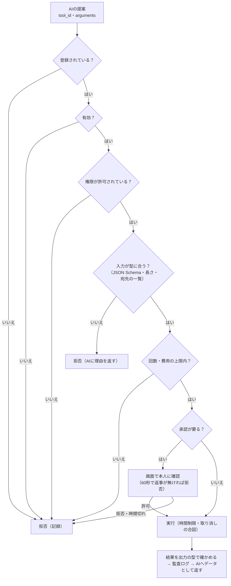

# 06 ツール実行・セキュリティ設計書

## 1. 方針

- **AI はツールの利用を「提案」するだけ。実行するかはツール実行基盤が決める**
- 実行の前に、登録・有効・権限・入力の型・回数・承認を必ず確かめる
- 任意のシェルコマンド・任意の Python コード・任意のファイルパス・任意の URL を実行させるツールは**作らない**
- 外から来た文字（チャット・声の文字起こし・ツールの結果・Web の内容）は**データ**であり、命令として扱わない
- 今のアプリの方針（押してよい画面の一覧、知らない画面で止まる、人に届く操作は本人の了解をとる）と揃える

## 2. ツールの登録

```python
# tools/spec.py
@dataclass(frozen=True)
class ToolSpec:
    tool_id: str                       # 一意。例 "clock.now"、"weather.lookup"
    name: str                          # 表示名
    description: str                   # AI に渡す説明（短く、何をして何を返すか）
    input_schema: dict                 # JSON Schema（additionalProperties: false、required を必ず書く）
    output_schema: dict                # 返す形
    permissions: frozenset[Permission] # 必要な権限
    timeout_seconds: float             # 既定 10
    max_calls_per_hour: int            # 既定 30
    confirmation: Literal["never", "always", "outside_allowlist"]
    retry: int = 0                     # 失敗時の再試行（既定しない）
    enabled_by_default: bool = False   # 既定は無効。本人がONにする
    version: str = "1"

class Tool(Protocol):
    spec: ToolSpec
    def run(self, args: dict, ctx: ToolContext, cancel: CancelToken) -> dict
```

- **登録はコードの中だけ**（`tools/builtin/` に置いて `registry.register(...)`）。設定ファイルや AI の出力からツールを増やせない
- 有効/無効は設定（`tool.<id>.enabled`）で切り替える。画面に一覧を出す（段階8）
- 判断の AI に渡すのは「有効で、今の権限で使える」ツールだけ

## 3. 権限

| 権限 | 例 | 既定 | 承認 |
|---|---|---|---|
| `read.local_app` | アプリ内の情報（時刻・タイマー・設定の一部）を読む | 許可 | 不要 |
| `read.local_files` | 決めたフォルダの中の決めた種類のファイルを読む | 禁止 | 一覧の外は必要 |
| `write.local_files` | 決めたフォルダに書く | 禁止 | 必要 |
| `net.read` | 一覧にある宛先から読む（天気・ニュースなど） | 禁止 | 一覧の外は禁止 |
| `net.send` | 外部へ送る・投稿する | 禁止 | **毎回必要** |
| `chat.post` | チャットに書き込む（既存の送信を使う） | 禁止 | 「承認して送る」モードでは毎回。「自動で送る」は本人がスイッチでONにしたときだけ（9章） |
| `voice.room` | AI の声を音声ルームに流す（他の人に聞こえる） | 禁止 | 本人がスイッチでONにしたときだけ |
| `app.settings` | アプリの設定を変える | 禁止 | 必要 |
| `ui.automation` | エミュレータの画面を操作する | 禁止 | 必要 |
| `delete` | 消す | 禁止 | 毎回必要 |
| `purchase` | 購入・課金・送金 | **作らない** | ― |
| `shell` / `code` | 任意のコマンド・コード | **作らない** | ― |

権限は今必要なものから始め、足すときはこの表に行を足す（権限の名前は `分類.内容` の形）。

## 4. 実行の流れ



- 入力の検証は JSON Schema で行う【要判断: `jsonschema` を依存に足すか、使う型（文字・数・列挙・長さ）だけの小さな検証を自分で書くか。最初は後者を推奨】
- 実行は専用のスレッド（最大2本）。時間切れのときは取り消しの合図を出し、結果は捨てる
- 結果は大きさの上限（例 4,000字）で切り、伏せ字を通してから AI に返す
- ネットワークを使うツールは、**宛先の一覧**（ひといきの `REQUEST_PATHS` と同じ考え方）の中だけ。リダイレクトで一覧の外へ行くなら止める

## 5. 人間による承認

| 項目 | 内容 |
|---|---|
| 出し方 | 画面のダイアログ（既存の `CTkToplevel` の作り）。ツール名・何をするか・引数（伏せ字を通した形）を表示 |
| 返事 | 「許可」「拒否」。60秒で返事が無ければ拒否 |
| その間のエージェント | HOLD（新しい発言はしない） |
| 「今後は聞かない」 | 作らない（承認が要るツールは毎回聞く）。聞かなくてよいツールは、権限の設定で `never` にする |

## 6. 監査ログ

ツールの提案と実行は、すべて `agent_data.db` の `tool_runs` 表に残す（07）。

| 列 | 内容 |
|---|---|
| tool_id・版 | ― |
| 提案した turn_id | どの判断から来たか |
| 引数 | 伏せ字を通した形 |
| 検証の結果 | 通った／どこで拒否したか |
| 承認 | 不要／許可／拒否／時間切れ |
| 結果 | 成功／失敗／時間切れ／取り消し、所要時間、結果の要約（伏せ字を通す） |

## 7. 機密情報

| 項目 | 方針 |
|---|---|
| APIキー | コードに書かない。平文で保存しない（DPAPI、05 の 3章）。ログ・画面・URL に出さない |
| 設定ファイル | 機密情報を入れない。エクスポートする機能を作るときもキーは含めない |
| ログの伏せ字 | 既存の `mask_screen_text`（第三者の名前）に、キーらしい文字列の伏せ字を足す。例外の文言も通す |
| AI に送る情報 | 本人の個人情報（住所・電話・本名など）を送らない。コンテキストに入れる前に形で検出して伏せる【要検証: 誤検出】 |
| スマホ連携の暗証番号 | 今は平文で保存（既存）。エージェントの範囲外だが、改善の候補として記録 |

## 8. 他の人のデータの守り（2026-10-15 追加: 声・人物像・関係性）

本人の要望（声の記憶・人物像の推定・関係性の値）は、**他の人の個人情報**を扱う。次を守る。

| # | 守り |
|---|---|
| H1 | 機能ごとに**本人が明示的にONにしたときだけ**動く（既定はOFF）。「声の照合」「人物像の推定」「関係性の値」は別々のスイッチ |
| H2 | **生の録音は保存しない**。文字起こしが終わったら捨てる |
| H3 | 声の特徴（声紋）を保存する場合は、DPAPI で暗号化し、このPCの外へ出さない。外部の API に送らない【要判断: そもそも声紋を使うか。最初は画面の席の表示で誰が話したかを決める】 |
| H4 | 人物像の推定は「推定」「確からしさ」「根拠」を必ず持ち、**事実として扱わない**。AI が本人に向かって口に出さない（04） |
| H5 | 健康・信条・性的指向・人種・犯罪歴など**繊細な事柄は推定させない**（判断・推定の指示で禁止し、出力に含まれたら捨てる） |
| H6 | 人ごとに、保存している情報を**見る・直す・消す**ことができる画面を作る（段階7）。「全部消す」もある |
| H7 | 保存期間を決め、過ぎたら消す（07） |
| H8 | 外部の AI に送るのは、判断・生成に必要な要約だけ（生の発言の長い履歴を送らない） |
| H9 | 公開リポジトリに、他の人のデータ（名前・発言・推定）を置かない（既存の伏せ字の方針と同じ） |

**法令・規約【要判断・未確認】**: 本人を見分けるための声の特徴データは、個人情報保護法の「個人識別符号」にあたりうる。
個人が私的に使う範囲での扱い、GRAVITY の利用規約での録音・自動化の扱いは、確認してから声紋の機能を作る。

## 9. 人に届く操作の守り

| 操作 | 守り |
|---|---|
| AI の声をスピーカーで鳴らす（本人だけが聞く） | 通常の設定で可 |
| **AI の声を音声ルームに流す**（出力先が VB-CABLE などでルームのマイクにつながっている） | `voice.room` 権限。本人がスイッチでONにしたときだけ。画面に「ルームに流しています」を常に表示。緊急停止ボタンを常に見える場所に置く |
| AI がチャットに書き込む（2026-10-15 追加要望: チャットで会話する） | `chat.post`。本人がスイッチでONにしたときだけ。モードは「承認して送る」（既定。下書きを見せ、60秒で捨てる）／「自動で送る」（頻度の上限を声より厳しく: 1分に1通・1時間に20通の案）。1通 250字以内、URL・個人情報らしいものは送らない。送信は既存の手入力送信の経路（監視ワーカー）だけを通す。緊急停止で送信待ちも捨てる |
| 既存の自動返信（キーワード） | 今まで通り（エージェントとは別）。両方がONのとき二重に反応しないよう、エージェントは「自動返信が返した行」を自分の発言扱いにする |

## 10. 実行の制限

| 対象 | 上限（既定の案） |
|---|---|
| ツールの実行 | 1つのまとまりで2回、1時間に30回（ツールごとに別に設定可） |
| ツールの時間 | 10秒（ツールごと） |
| AI の呼び出し | 1分に6回、1日に◯回（費用の上限と合わせて設定） |
| AI の再試行 | 1回 |
| 発言 | 1分に2回、1時間に30回 |
| 待ち行列 | 受付箱100、ツール10、合成10、再生10 |
| 緊急停止 | どの状態からでも。手で再開するまで何もしない |
