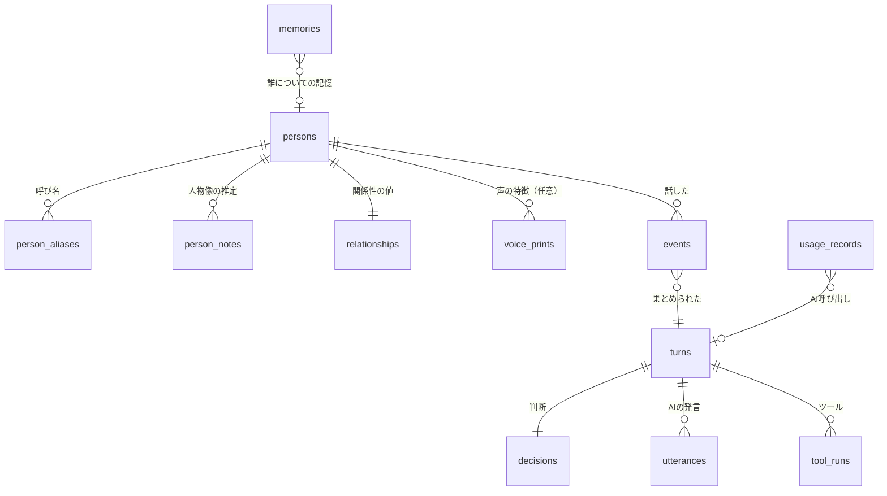

# 07 データ・記憶設計書

## 1. 保存先【推奨・要判断】

| 案 | 内容 | 判断 |
|---|---|---|
| **A（推奨）** | 新しい SQLite ファイル `agent_data.db` をアプリのフォルダ（`app_data.db` の横）に置く | 既存の表を変えずに済む。消す・バックアップするのも別にできる。他の人のデータを既存の設定と混ぜない |
| B | 既存の `app_data.db` に表を足す | 1ファイルで済むが、設定と他の人のデータが混ざる |

**自動更新との関係【事実】**: 差し替えは `robocopy /E`（足すだけで消さない）なので、配布物に含まれないファイルは残る。
ただし念のため、段階3で `/XF` に `agent_data.db`・`-wal`・`-shm` を足す（配布物にうっかり入っても上書きされないように）。

設定（機密でないもの）は今まで通り `app_data.db` の `settings` 表に置く（キー名は `agent.` で始める）。APIキーは同じ表に暗号文で（05）。

## 2. データモデル

| 表 | 主な列 | 保存期間（既定の案） |
|---|---|---|
| `events` | event_id, kind, source, key, person_id, speaker_raw, text, observed_at, meta(JSON), is_self | **7日** |
| `turns` | turn_id, started_at, event_ids(JSON), state, closed_at | 30日 |
| `decisions` | turn_id, action, reason, urgency, decided_by(rule/llm), rule_id, model, created_at | 30日 |
| `utterances` | turn_id, text, emotion, voice, status(spoken/cancelled/failed), started_at, ended_at | 30日 |
| `tool_runs` | 06 の監査ログの列 | 90日 |
| `memories` | memory_id, scope(person/room/self/world), person_id, content, source_event_ids, confidence, importance, created_at, updated_at, expires_at, pinned | 下記 |
| `persons` | person_id, display_name, first_seen_at, last_seen_at, source(gravity/voice), consent_flags(JSON) | 最後に見てから180日 |
| `person_aliases` | person_id, alias（チャット欄の「名前..」、席の表示名など） | persons と同じ |
| `person_notes` | person_id, kind(style/topics/tempo/...), content, confidence, evidence_event_ids, updated_at | persons と同じ |
| `relationships` | person_id, closeness, warmth, familiarity, last_interaction_at, history(JSON 直近の変化) | persons と同じ |
| `voice_prints` | person_id, model_name, embedding（**DPAPI で暗号化**）, created_at | 機能をONにしている間のみ。OFFで全削除 |
| `usage_records` | at, provider, model, purpose, input_tokens, output_tokens, cached_tokens, estimated_cost, turn_id | 1年（集計後は日ごとにまとめる） |
| `persona` | persona_id, json（04 の Persona） | 消さない |

- 時刻は UTC の UNIX 秒で保存し、表示のときに日本時間にする
- 他の人の名前・発言は `events`・`persons` などに**そのまま**入る（判断に要るため）。だから保存期間を短くし、画面から消せるようにする（06 の H6・H7）

## 3. 会話履歴（短期）

- 判断のたびに DB から読み直さず、メモリ上に**直近の窓**（最大 200 件・30 分）を持つ。DB は記録と再起動後の復元のため
- 再起動したら、直近 30 分の `events` を窓に戻す（`meta.backlog=True` として扱い、反応はしない）
- AI 自身の発言・判断・ツールの結果も窓に入れる（コンテキストの「自分の直近の発言」「判断の履歴」に使う）

## 4. 長期記憶

### 4.1 何を残すか

| 種類 | 例 | 残し方 |
|---|---|---|
| 人について（person） | 「〇〇さんは夜勤明けによく来る」「アニメの話が好き」 | 推定の扱い（確からしさ・根拠つき） |
| 場について（room） | 「このルームは雑談中心」「毎週金曜に集まる」 | 同上 |
| AI 自身（self） | 「先週〇〇さんに映画を勧めた」 | 事実（自分の発言の記録から） |
| 本人が教えたこと | 設定画面で本人が書いた覚え書き | `pinned=True`（自動で消さない） |

**残さないもの**: 06 の H5 の繊細な事柄、本人の個人情報、APIキー・暗証番号など。

### 4.2 選び方（いつ・どうやって残すか）

1. 判断で `observe` / `react` / `engage` になったまとまりのうち、**新しい情報がありそうなもの**を候補にする
2. 一定時間ごと（例 10分）か、会話が途切れたときに、候補をまとめて AI に「残すべき記憶」を構造化出力で出させる（`purpose="summarize"`）
3. 出てきたものを、既存の記憶と比べて**足す・更新・捨てる**を決める（同じ内容は更新、矛盾したら確からしさを下げる）
4. 重要度・確からしさが低いものは期限を短く（例 30日）、高いものは長く（例 180日）

### 4.3 使い方（コンテキストに入れる）

- まずは**単純な絞り込み**: 今回の発言者の記憶 → 今の話題の言葉が含まれる記憶 → 重要度が高い順、で最大5件
- 意味の近さで探す仕組み（埋め込み）は**今は入れない**【要判断: 記憶が増えて単純な絞り込みで足りなくなってから】

### 4.4 更新・削除

| 操作 | 方法 |
|---|---|
| 見る | 画面の「記憶」一覧（人ごと・場ごと） |
| 直す | 本人が書き換える（`pinned` にもできる） |
| 消す | 1件ずつ、人ごと、全部 |
| 期限切れ | 起動時と1日1回、期限を過ぎたものを消す |

## 5. 人物モデル（2026-10-15 追加: 声の記憶・人物像・関係性の値）

### 5.1 誰かを見分ける

| 段階 | 方法 | 状態 |
|---|---|---|
| 1 | チャット欄の名前（`shimmerTextView`。長いと「名前..」で切れる） | 【事実】読める。切れた名前は先頭一致で同じ人とみなす（既存の `friend_name_matches` の考え方） |
| 2 | 音声ルームの席の表示（話している席）と、席の名前 | 【要検証】 |
| 3 | 声の特徴（声紋）での照合 | 【要判断】法令・規約・精度・依存。06 の H3 |

同じ名前の別人・名前を変えた人がいるので、`persons` には「確からしさ」を持たせ、本人が画面で**まとめる・分ける**ことができるようにする。

### 5.2 声の記憶

「その人が声で何を話したか」を、文字起こしとして `events`（kind=`voice_utterance`）に残す。**音そのものは残さない**（06 の H2）。
声紋を使う場合も、保存するのは数値の特徴（埋め込み）だけで、DPAPI で暗号化する。

### 5.3 人物像の推定

| 項目 | 内容 |
|---|---|
| 材料 | その人の発言の文（話題・言葉づかい）、話し方の特徴（話す速さ・声の大きさ・発言の頻度・話す時間帯。**音から取れる範囲は要検証**） |
| 作り方 | 会話が途切れたときなどに、AI に `person_notes` の候補を構造化出力で出させる。1つの推定に「確からしさ（低/中/高）」「根拠の出来事」を必ず付ける |
| 中身の例 | 話すテンポ（ゆっくり/早口）、冗談への反応、よく話す話題、静かに聞いてほしそうか |
| 禁止 | 06 の H5 の繊細な事柄。性格の断定（「〇〇な人」ではなく「〇〇な傾向がありそう（推定・低）」） |
| 使い方 | 04 の 8章（接し方の参考。口に出さない） |

### 5.4 関係性の値

AI とその人との関係を表す数値。**AI の接し方を変えるためだけ**に使う（04）。

| 値 | 範囲 | 意味 | 動き方 |
|---|---|---|---|
| familiarity（なじみ） | 0〜100 | 会った回数・やりとりの量 | やりとりのたびに少し上がる。会わない日が続くとゆっくり下がる |
| warmth（温かさ） | -100〜100 | やりとりが和やかか、ぎくしゃくしたか | 会話のまとまりごとに AI が評価（-2〜+2）し、少しずつ反映 |
| closeness（親しさ） | 0〜100 | 上の2つから計算（表示・判断に使う代表値） | 計算で決まる |

- 1回のまとまりで動く量に上限を付ける（急に親しくなったり、敵対したりしない）
- 変化は `relationships.history` に理由つきで残し、画面で見られるようにする。本人が値を直せる
- 値を口に出さない。値が低い人を無視する、のような使い方はしない（04）

## 6. データ保護

| 項目 | 方針 |
|---|---|
| 置き場所 | このPCの中だけ（`agent_data.db`）。外部の AI に送るのは判断・生成に必要な要約だけ |
| 暗号化 | APIキー・声紋は DPAPI。そのほかの表は暗号化しない（このPCのユーザーの領域にあるため）【要判断: 全体を暗号化するか】 |
| 公開リポジトリ | `agent_data.db` を `.gitignore` に足す（段階3） |
| テスト | 伏せ字にした出来事だけを使う（既存の `make_fixture.py` の方針） |

## 7. バックアップと復旧

| 項目 | 方法 |
|---|---|
| バックアップ | 起動時に1日1回、`agent_data.db` を SQLite のバックアップ機能で `backup/agent_data_YYYYMMDD.db` に写す（最大7世代）。既存の自動更新のバックアップとは別 |
| 壊れたとき | 開けない・整合性の確認（`PRAGMA integrity_check`）に失敗したら、名前を変えて退避し、最新のバックアップから戻す。だめなら空で作り直す（エージェントは記憶なしで動く） |
| 表の変更 | `schema_version` を持ち、起動時に順番に移し替える（既存の `_migrate_*` と同じやり方） |
| 全部消す | 画面から。ファイルごと消して作り直す |
