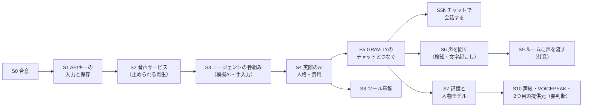

# 09 段階的実装計画

## 進め方の約束

- 1段階ずつ作り、**既存のテストが全部通る**ことと、その段階のテストが通ることを確かめてから次へ進む
- 将来の機能を先回りして作らない。インターフェースだけ用意し、中身は必要になった段階で作る
- 人に届くこと（ルームに声を流す・チャットに書く・外部へ送る）は、後の段階で、本人の了解をとってから
- 実際の AI API を使う確認は、費用がかかるので本人の了解をとってから流す（`--live`）
- 各段階の終わりに、開発ログに経緯を書き、本人の確認をもらってからコミットする

## 全体の順番

---

## S0 合意（この設計書）

| 項目 | 内容 |
|---|---|
| 実現すること | 設計の合意。00 の「本人に決めてほしいこと」の答え |
| 完了条件 | エージェントを置く場所（D1）が決まる。少なくとも S1〜S3 に進んでよいと言われる |
| 次へ進む条件 | 本人の承認 |

## S1 AI APIキーの入力と保存（本人の要望）

**状態: 2026-10-15 実装済み**（提供元は本人の決定で「まだ決めない」→ 選択肢は「未定」と「テスト用（模擬）」。モジュール名は `agent/api_keys.py`）

| 項目 | 内容 |
|---|---|
| 実現すること | 設定タブの「🤖 AI API」区画: 提供元の選択、キーの欄（隠す）、👁、💾保存、🗑削除、🔌接続確認、状態の表示。キーは DPAPI で暗号化して保存 |
| なぜ | 本人の要望。どの AI 機能もキーが要る。機密情報の扱いを最初に固める |
| 変更するファイル | 新規 `files/agent/__init__.py`・`files/agent/api_keys.py`（DPAPI）・`files/agent/llm/base.py`（`LLMProvider`・`ping` の型）・`files/agent/llm/mock.py`。既存 `files/auto_reply_app.py`（`build_ai_api_section` を設定タブに足す、ログの伏せ字にキーの伏せ字を足す）。`files/RELEASE_README.md`（使い方）。新規 `tests/test_agent_api_keys.py`・`tests/test_gui_ai_api.py` |
| 依存 | なし（`ctypes` は標準）。提供元の SDK は、提供元が決まったら（決まるまでは模擬の提供元だけ） |
| 完了条件 | 保存→再起動→読み出しで同じキー。DB には暗号文だけ。ログ・画面にキーが出ない。接続確認が模擬で3通り表示される。既存のテストが全部通る |
| テスト | 05 の 3.3、08 の T33・T42・T44 |
| 想定される問題 | PyInstaller で `agent/` が同梱されるか（import していれば入るはず。ビルドで確かめる）／DPAPI が使えない環境（このアプリは Windows のみ） |
| 次へ進む条件 | 本人が画面で保存・削除・接続確認を試して問題ない |

## S2 音声サービス（止められる再生）

| 項目 | 内容 |
|---|---|
| 実現すること | `agent/speech/`: 共通の音声合成インターフェース、AivisSpeech・VOICEVOX のアダプター（既存と同じ動き）、途中で止められる再生、順番と優先度。既存の読み上げ・アラームもここを通す。「音声を止める」ボタン |
| なぜ | AI の発言を止める・譲るために、再生を止められる必要がある（今は止められない）。既存の読み上げと AI が同時に鳴らないように |
| 変更するファイル | 新規 `files/agent/speech/*.py`。既存 `auto_reply_app.py`（`request_speech`・`_speech_worker`・`synthesize_voice_wav`・`_play_wav_bytes` を音声サービスへつなぎ替え。**関数名と入口は残す**） |
| 依存 | S1 の `agent/` パッケージ |
| 完了条件 | 既存の読み上げ（手入力・クリップボード・スマホ）・アラームが今まで通り鳴る。再生を0.2秒以内に止められる。話者の保存形式「エンジン名:ID」・キャッシュ・自動起動が今まで通り |
| テスト | 08 の T21〜T28。既存の全テスト。手で: 読み上げ・アラーム・スマホ連携・出力先の切り替え（VB-CABLE） |
| 想定される問題 | 区切って書き込むと音が途切れる（区切りの長さを調整）／MME の遅れ／既存のスレッドとの二重の再生 |
| 次へ進む条件 | 本人が今の使い方（読み上げ・アラーム・ルームへの読み上げ）で問題ないと確かめる |

## S3 エージェントの骨組み（模擬AI・手入力）

| 項目 | 内容 |
|---|---|
| 実現すること | 出来事・受付箱・本体（状態）・規則の関所・コンテキスト・判断と生成の型・出す前の確認・`agent_data.db`（出来事・判断・発言・利用量）。新しい「AI」タブ: 開始/停止/緊急停止、**手入力で出来事を入れて試す欄**、判断のログ。AI は模擬（台本どおりに返す） |
| なぜ | チャットアプリや実際の AI が無くても、判断→沈黙/発言→音声の流れを確かめられるようにする（F11） |
| 変更するファイル | 新規 `files/agent/{events,inbox,runtime,gate,context,decision,generation,persona,config,usage,audit,cancel}.py`・`files/agent/memory/store.py`。既存 `auto_reply_app.py`（AIタブ、終了時の後片付け）、`.gitignore`（`agent_data.db`）、自動更新の `/XF` に `agent_data.db` を足す |
| 依存 | S2 |
| 完了条件 | 手入力の出来事で、沈黙・反応・保留が判断の記録どおりに動く。沈黙のとき合成も再生もしない。緊急停止で何もしなくなる。終了時に全スレッドが止まる |
| テスト | 08 の T1〜T9、T29、T31〜T32、T36〜T39 |
| 想定される問題 | 状態の扱いが複雑になる（状態遷移の表どおりかをテストで固定する） |
| 次へ進む条件 | 本人が AI タブで手入力して、沈黙と発言の動きを確かめる |

## S4 実際の AI・人格・費用

| 項目 | 内容 |
|---|---|
| 実現すること | 提供元のアダプター1つ（本人が決めたもの）。判断と生成の指示（プロンプト）、人格の設定画面、費用の見積もりと上限、DEGRADED |
| なぜ | 実際の判断の質を確かめる |
| 変更するファイル | 新規 `files/agent/llm/<提供元>.py`、`requirements.txt`（版を固定）、spec（必要なら hiddenimports）。既存 `auto_reply_app.py`（人格・上限の設定画面） |
| 依存 | S3、提供元とモデルの決定、本人の APIキー |
| 完了条件 | 手入力の場面集（10〜20場面）で、発言すべき/沈黙すべきの判断が本人の感覚と合う割合を測り、本人が良しとする。費用の上限で止まる |
| テスト | 08 の T10〜T13、T40。場面集を実際の API で流す（`--live`。費用を見積もって本人の了解をとる） |
| 想定される問題 | 判断が慎重すぎる/喋りすぎる（指示と規則の値で調整）／遅れ（1回か2回かを測る） |
| 次へ進む条件 | 場面集の結果と1日の費用の見込みを本人が確かめる |

## S5 GRAVITY のチャットとつなぐ

| 項目 | 内容 |
|---|---|
| 実現すること | 監視ループから、チャット欄の新しい行を出来事にして渡す（`GravityChatBridge`）。自動返信（キーワード）と同時に動かすときの二重反応の防止。**AI の声はスピーカーだけ**（ルームへは流さない） |
| なぜ | 実際の会話で試す |
| 変更するファイル | 既存 `auto_reply_app.py`（監視ループに出来事を渡す口を足す。キーワード自動返信の動きは変えない） |
| 依存 | S4 |
| 完了条件 | 実際のルームで、出来事が重複せず届く。AI はスピーカーにだけ喋る。キーワード自動返信が今まで通り |
| テスト | 08 の T30。既存の監視のテスト（`test_keyword_targets.py` など）が全部通る。手で実際のルーム |
| 想定される問題 | 同じ人の同じ発言が区別できない（P6）／監視の周回が遅くなる（出来事を作る処理は軽く） |
| 次へ進む条件 | 本人が実際のルームで、聞こえ方・頻度を確かめる |

## S5b チャットで会話する（2026-10-15 追加要望）

| 項目 | 内容 |
|---|---|
| 実現すること | 出力の振り分け（声／チャット／両方）、チャット出力（既存の手入力送信の待ち行列へ）、承認のダイアログ（下書き）、チャット用の文の作り方、`chat.post` のスイッチと上限 |
| なぜ | チャット欄の行（箱と値）と入力欄を活かして、文字で会話する |
| 変更するファイル | 新規 `files/agent/output.py`。既存 `auto_reply_app.py`（`ChatSender` として `enqueue_manual_texts` を渡す、承認のダイアログ、設定のスイッチ） |
| 依存 | S5（チャットの出来事が届くこと） |
| 完了条件 | 承認モードで、下書き→送る→チャットに出る→自分の発言として扱われ反応しない、が通る。自動モードの上限が効く。キーワード自動返信と二重に反応しない |
| テスト | 08 の T45〜T50。既存の手入力送信のテスト（`test_manual_send.py`・`test_regression_manual_memory.py`）が全部通る |
| 想定される問題 | 手入力の送信と AI の送信が同じ待ち行列で順番が混ざる（AI の分に印を付けて扱いを分ける）／自分の発言の記録の上限（手入力の約束を壊さない: 別の箱を使う既存の作りに合わせる） |
| 次へ進む条件 | 本人が承認モードで実際のルームで試し、自動モードにするかを決める |

## S6 声を聞く（検知・文字起こし・譲る）

| 項目 | 内容 |
|---|---|
| 実現すること | ルームの音を拾う、話し始め/終わりの検知、文字起こし、LISTENING の状態、AI が喋っている途中で譲る |
| なぜ | 本人の追加要望（話し始めたら聞き、全体の内容から話すか無視するかを決める） |
| 変更するファイル | 新規 `files/agent/listen/*.py`。既存 `auto_reply_app.py`（入力デバイスの選択を流用・聞き取りの設定） |
| 依存 | S5。事前の検証: 音の拾い方（ループバック／仮想デバイス）、文字起こしの方式（ローカル／API）と費用、自分の声の除き方 |
| 完了条件 | 他の人が話している間は AI が話し始めない。話し終わったら内容を踏まえて判断する。生の録音が残らない |
| テスト | 08 の T7・T24・T43。手で実際のルーム |
| 想定される問題 | 拾った音に自分の声が混ざる／文字起こしの遅れ・誤り／依存の追加（PyInstaller の同梱） |
| 次へ進む条件 | 本人が実際のルームで、譲り方と聞き取りの精度を確かめる |

## S7 記憶と人物モデル

| 項目 | 内容 |
|---|---|
| 実現すること | 長期記憶（候補→要約→足す/更新/捨てる）、人物（名前・席の表示で見分ける）、人物像の推定、関係性の値、画面で見る・直す・消す、保存期間、バックアップ |
| なぜ | 過去の文脈を踏まえる。本人の追加要望（声の記憶・人物像・関係性） |
| 変更するファイル | 新規 `files/agent/memory/selection.py`、`store.py` に表を足す。既存 `auto_reply_app.py`（記憶・人物の画面） |
| 依存 | S5（S6 があれば声の発言も記憶に入る） |
| 完了条件 | 繊細な事柄が保存されない。人ごとに消せる。期限で消える。関係性の値が理由つきで少しずつ動く |
| テスト | 08 の T35、記憶の選び方・期限・削除のテスト |
| 想定される問題 | 同じ名前の別人（まとめる/分ける画面）／記憶が増えて送る量が増える（上限で切る） |
| 次へ進む条件 | 本人が保存されている内容を見て、残してよい範囲か確かめる |

## S8 ツール基盤

| 項目 | 内容 |
|---|---|
| 実現すること | ToolSpec・登録・検証・権限・承認のダイアログ・監査ログ。最初のツールは害の無いもの1つ（例: 時刻・タイマーの残りを返す） |
| なぜ | 外部 API・ローカル機能を後から足せるようにする |
| 変更するファイル | 新規 `files/agent/tools/*.py`。既存 `auto_reply_app.py`（ツールの一覧と有効/無効、承認のダイアログ） |
| 依存 | S4 |
| 完了条件 | 08 の T14〜T20 が通る。AI がツールを提案し、検証を通ったものだけが実行される |
| テスト | 08 の T14〜T20 |
| 想定される問題 | 入力の検証の範囲（自前の小さな検証で足りるか） |
| 次へ進む条件 | 本人が追加したいツールを決める（1つずつ ToolSpec を書いて足す） |

## S9 AI の声を音声ルームに流す（任意）

| 項目 | 内容 |
|---|---|
| 実現すること | `voice.room` の権限・スイッチ・常時の表示・緊急停止。出力先が VB-CABLE などのときだけ |
| なぜ | AI を会話に参加させる（他の人に聞こえる） |
| 依存 | S5・S6（譲る仕組みがあること）。本人の判断（D13）。GRAVITY の利用規約の確認 |
| 完了条件 | スイッチがOFFのときはルームに流れない。ONの間は画面に常に表示。緊急停止ですぐ止まる |
| 次へ進む条件 | 本人が、人に聞こえる状態で試すと決める |

## S10 要判断・要検証の残り

| 項目 | 前提 |
|---|---|
| 声紋による照合 | 法令・規約・精度を確かめ、本人が使うと決めたとき（06 の H3・8章） |
| VOICEPEAK | 入手し、連携方式・利用条件・対応機能を調べてから（05 の 4.3） |
| 2つ目の AI 提供元 | 必要になったとき（05 の 2.4 の手順） |
| チャットへの書き込み（`chat.post`） | S5b に移した（2026-10-15 追加要望） |
